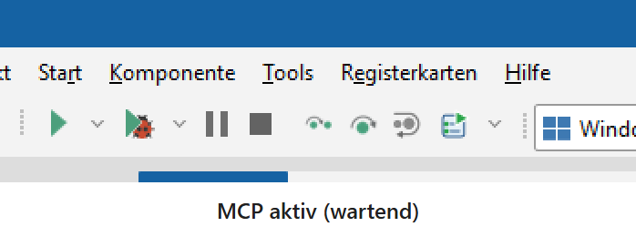
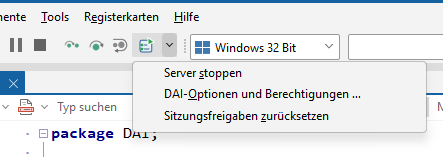
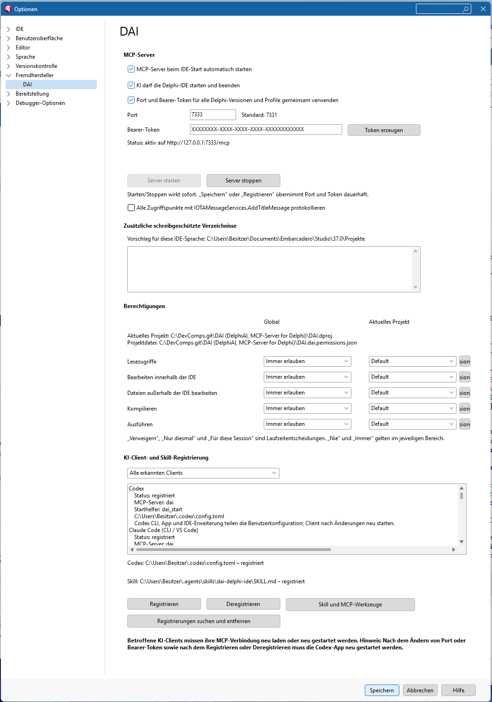

# DAI – Delphi AI (MCP-Server für Delphi-IDE)

**Home:** <https://geheimniswelten.github.io/#dai>

**Download:** ~~<https://github.com/geheimniswelten/DAI/releases>~~

**Clients:** Codex, Claude Code (CLI / VS Code), Claude Desktop, Eigent, Gemini CLI / Code Assist, ~~Gemini Desktop~~, Hermes, LM Studio and OpenClaw

  
<b>Client-List</b>

  | Client                    | DAI connection    | Setup/Register |
  |---------------------------|-------------------|----------------|
  | Codex App / CLI / IDE     | HTTP              | via DAI        |
  | Claude Code CLI / VS Code | HTTP              | via DAI        |
  | Claude Desktop            | **STDIO**+Bridge  | via DAI        |
  | Gemini CLI / Code Assist, VS-Code-AgentMode   | HTTP | via DAI |
  | Hermes                    | HTTP              | via DAI        |
  | LM Studio                 | HTTP              | via DAI        |
  | OpenClaw                  | HTTP              | via DAI        |
  | Eigent                    | HTTP or **STDIO** | manually via its MCP settings |
  | Gemini Desktop / Consumer | -                 | **not implemented** |

## Install

**Script**
* compile and register (Delphi 11 ➔ 13)
* .\\Build+Register.cmd -> .\\Build.ps1 

**Manual**
* open in Delphi and "install" the package
* .\\DAIProjectGroup.groupproj

**only Register**
* copy the matching package from `Build/Win32/DAI???.bpl` or `Build/Win64/DAI???.bpl` (architecture of the IDE)
* copy `DAI.McpBridge.exe` from the same output directory alongside the BPL (STDIO bridge and `dai_start`)
* register the BPL in `HKCU\Software\Embarcadero\BDS\<IDE version>\Known Packages` or `Known Packages x64`
* Delphi 11 / 12 / 13 use IDE registry versions `22.0` / `23.0` / `37.0`; only register Win64 when that IDE is installed

**the last step**
* check if the port is free
* define authentication/bearer token (arbitrary text)
* basic permissions?
* and now just register with the AI ​​clients
 
---

  
<b>[EN] English</b>

  - **Manage the Delphi-IDE and create, modify or debug your Applications with AI**
  - Tested with Delphi 11 and 13
  - Search source code (read-only): OpenToolsAPI, Delphi sources (RTL/VCL/FMX), demos, installed GetIt packages (user and shared repositories), and optional additional directories
  - Local SQLite declaration indexes for Delphi/ToolsAPI, GetIt, the project and project group
  - DAI user interface in English, German, French or Japanese, following the IDE language
  - Optional shared Windows port reservations for multiple users and participating applications
    

      
<b>Details</b>

      | Function group | Tools | Functions |
      |---|---:|---|
      | Reference sources | 3 | List Delphi, demo and user/shared GetIt paths; list and read reference files |
      | File lists and search | 4 | List project/directory files; search names and contents, including RegEx |
      | Search indexes and symbols | 5 | Create, update and delete local Delphi/ToolsAPI, GetIt, project and group indexes; search declarations and run read-only SQL queries |
      | Files and editor | 7 | List loaded files even without editor tabs; read, write, open, activate, close and remove files from projects |
      | Projects and project group | 7 | Create, open, activate, save and remove projects; read type/framework, active configuration/platform, package status, build context and index availability |
      | Unit and form creation | 2 | Create units and VCL form units |
      | Form designer | 10 | Open designer/form text; search, select and create components; read/change properties; move, resize and change parents; list palette components |
      | Code Insight | 4 | Query provider status, symbol definitions, symbol help and diagnostics |
      | IDE AI status | 1 | List registered OTA AI providers and their enabled chat/instruction capabilities; no model request |
      | IDE status and control | 2 | Read status; control IDE windows and close the IDE |
      | Windows and dialogs | 5 | Inspect windows and active dialogs; operate dialog buttons |
      | Logs and messages | 4 | Read compiler/debugger logs; display messages, input dialogs and hints |
      | Project options | 4 | Read configurations, platforms and option values; set or remove values |
      | Find and open options | 2 | Find and open IDE/project options; navigate and focus fields, including through IDE Insight |
      | Packages | 3 | Install and uninstall built packages; check installation status |
      | Compilation | 4 | Compile projects and the project group; run MSBuild and DCC32 |
      | Execution | 2 | Run projects with or without the debugger; stop execution |
      | Debugger control and overview | 4 | Read status, threads and stack; pause, resume and step |
      | Debugger expressions | 5 | Read, evaluate and modify cursor expressions; query results and invoke native watch/inspector actions |
      | Breakpoints | 3 | List, set, update and remove breakpoints |
      | Client and skill registration | 6 | Configure, inspect and remove MCP client connections and the Codex skill |

      **87 DAI tools.** Indexes are built locally without AI calls, only on explicit request. Indexed sources may have changed; read the current source before using a result.

      **Additional `dai_start` helper (3 tools):** `delphi_status`, `delphi_start`, `delphi_stop` check, start and normally close Delphi, even when DAI is unavailable. Force termination requires an explicit request.

      [Detailed documentation](../README.md)

    

---

  
<b>[DE] Deutsch</b>

  - **Verwalte die Delphi-IDE und erstelle, bearbeite oder debugge deine Anwendungen mit der KI**
  - Delphi 11 und 13 getestet
  - Quelltexte durchsuchen (read-only): OpenToolsAPI, Delphi-Sourcen (RTL/VCL/FMX), Demos, installierte GetIt-Pakete (Benutzer- und globale Repositories) und zusätzliche Verzeichnisse
  - Lokale SQLite-Deklarationsindizes für Delphi/ToolsAPI, GetIt, Projekt und Projektgruppe
  - DAI-Oberfläche auf Deutsch, Englisch, Französisch oder Japanisch, entsprechend der IDE-Sprache
  - Optionale gemeinsame Windows-Portreservierung für mehrere Benutzer und beteiligte Anwendungen
    

      
<b>Details</b>

      | Funktionsgruppe | Tools | Funktionen |
      |---|---:|---|
      | Referenzquellen | 3 | Delphi-, Demo-, Benutzer-/globale GetIt-Pfade sowie Referenzdateien auflisten und lesen |
      | Dateilisten und Suche | 4 | Projekt-/Verzeichnisdateien auflisten; Namen und Inhalte suchen, auch mit RegEx |
      | Suchindizes und Symbole | 5 | Lokale Delphi-/ToolsAPI-, GetIt-, Projekt- und Gruppenindizes erstellen, aktualisieren und löschen; Deklarationen suchen und lesende SQL-Abfragen ausführen |
      | Dateien und Editor | 7 | Geladene Dateien auch ohne Editor-Tab auflisten; Dateien lesen, schreiben, öffnen, aktivieren, schließen und aus Projekten entfernen |
      | Projekte und Projektgruppe | 7 | Projekte erstellen, öffnen, aktivieren, speichern und entfernen; Typ/Framework, aktive Config/Plattform, Package-Status, Buildkontext und Indexverfügbarkeit lesen |
      | Units und Formulare erstellen | 2 | Neue Units und VCL-Formular-Units erstellen |
      | Formdesigner | 10 | Designer/Formulartext öffnen; Komponenten suchen, auswählen und erstellen; Properties lesen/ändern; Position, Größe und Parent ändern; Komponentenpalette auslesen |
      | Code Insight | 4 | Providerstatus, Symboldefinitionen, Symbolhilfe und Diagnosen abfragen |
      | IDE-KI-Status | 1 | Registrierte OTA-KI-Provider und deren aktivierte Chat-/Instruction-Funktionen abfragen; kein Modellaufruf |
      | IDE-Status und Steuerung | 2 | Status abfragen; IDE-Fenster steuern und IDE schließen |
      | Fenster und Dialoge | 5 | Fenster und aktive Dialoge untersuchen; Dialogbuttons bedienen |
      | Logs und Meldungen | 4 | Compiler-/Debuggerlogs lesen; Meldungen, Eingabedialoge und Hinweise anzeigen |
      | Projektoptionen | 4 | Konfigurationen, Plattformen und Optionswerte lesen; Werte setzen oder entfernen |
      | Optionen suchen und öffnen | 2 | IDE-/Projektoptionen suchen und öffnen; Navigation und Feldfokus, auch über IDE Insight |
      | Packages | 3 | Bereits gebaute Packages installieren, deinstallieren und Installationsstatus prüfen |
      | Kompilieren | 4 | Projekte und Projektgruppe kompilieren; MSBuild und DCC32 ausführen |
      | Ausführen | 2 | Projekte mit oder ohne Debugger starten und stoppen |
      | Debuggersteuerung und Übersicht | 4 | Status, Threads und Stack lesen; pausieren, fortsetzen und Einzelschritte ausführen |
      | Debugger-Ausdrücke | 5 | Cursorausdrücke lesen, auswerten und ändern; Ergebnisstatus und native Watch-/Inspektoraktionen |
      | Haltepunkte | 3 | Haltepunkte auflisten, setzen, aktualisieren und entfernen |
      | Client- und Skillregistrierung | 6 | MCP-Clientanbindungen und Codex-Skill einrichten, prüfen und entfernen |

      **87 DAI-Werkzeuge.** Indizes werden lokal ohne KI-Aufruf und nur auf ausdrückliche Anforderung aufgebaut. Indizierte Quellen können inzwischen geändert sein; vor Verwendung den aktuellen Quelltext lesen.

      **Zusätzlicher Starthelfer `dai_start` (3 Werkzeuge):** `delphi_status`, `delphi_start`, `delphi_stop` prüfen, starten und schließen Delphi regulär, auch bei unerreichbarem DAI. Hartes Beenden erfordert einen ausdrücklichen Auftrag.

      [Ausführliche Dokumentation](../README.md)

    

---

